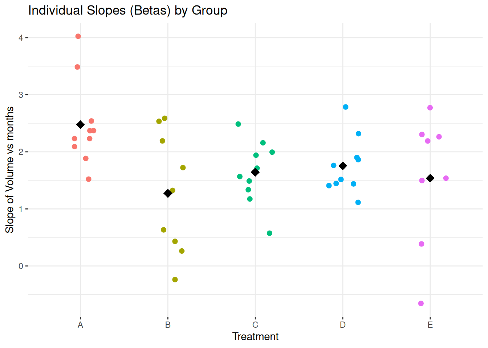

# Response feature analysis

Response feature analysis is a two-stage approach for analyzing
longitudinal tumor growth data. It summarizes each subject’s growth
trajectory using an interpretable response feature and compares these
features across treatment groups.

The [`rfeat()`](https://pbreheny.github.io/tumr/reference/rfeat.md)
function implements this approach by estimating subject-specific growth
slopes and performing statistical comparisons between treatment groups.

## Preparing the data

We use the `melanoma2` dataset included with the package.

``` r

library(tumr)
data("melanoma2")

melanoma2$months <- melanoma2$Day / (365 / 12)
mel2 <- tumr(melanoma2, ID, months, Volume, Treatment)
```

## Fitting response feature analysis

The [`rfeat()`](https://pbreheny.github.io/tumr/reference/rfeat.md)
function:

1.  Estimates a growth slope for each subject.
2.  Summarizes the slopes within each treatment group.
3.  Performs statistical comparisons between groups.

Available comparisons include t-tests, ANOVA, Tukey post-hoc tests, and
a combination of ANOVA and Tukey tests.

The following example uses `comparison = "both"` to perform ANOVA and
Tukey post-hoc comparisons.

``` r

rfeat_mel2 <- rfeat(mel2, comparison = "both")
rfeat_mel2
```

    $anova
                Df Sum Sq Mean Sq F value Pr(>F)
    Group        4  7.794  1.9485   2.938 0.0314 *
    Residuals   42 27.853  0.6632
    ---
    Signif. codes:  0 '***' 0.001 '**' 0.01 '*' 0.05 '.' 0.1 ' ' 1

    $tukey
      Tukey multiple comparisons of means
        95% family-wise confidence level

    Fit: aov(formula = Beta ~ Group, data = betas)

    $Group
              diff        lwr        upr     p adj
    B-A -1.2033657 -2.2696725 -0.1370590 0.0200139
    C-A -0.8320576 -1.8699243  0.2058092 0.1701000
    D-A -0.7204285 -1.7582952  0.3174383 0.2941216
    E-A -0.9384152 -2.0392391  0.1624087 0.1274422
    C-B  0.3713082 -0.6949985  1.4376149 0.8572838
    D-B  0.4829373 -0.5833695  1.5492440 0.6982531
    E-B  0.2649505 -0.8627267  1.3926278 0.9618601
    D-C  0.1116291 -0.9262377  1.1494958 0.9980027
    E-C -0.1063576 -1.2071816  0.9944663 0.9986875
    E-D -0.2179867 -1.3188107  0.8828372 0.9794890

## Visualizing response features

The [`plot()`](https://rdrr.io/r/graphics/plot.default.html) method
displays individual subject slopes and group-level mean estimates.

``` r

plot(rfeat_mel2)
```



This visualization provides a convenient way to examine variation in
tumor growth rates across subjects and treatment groups.
