# Getting started

The `tumr` package provides tools for visualizing and analyzing
longitudinal tumor growth data. This guide demonstrates its core
functionality, including tumor growth visualization and linear
mixed-effects modeling, using the `melanoma2` dataset included with the
package. All code required to reproduce the examples is provided below.

## Data preparation

### Loading the data

First, load the package and the example dataset.

``` r

library(tumr)
data("melanoma2")
```

### Creating a tumr object

Most functions in `tumr` operate on a `tumr` object, which stores the
longitudinal data along with its associated metadata, including subject
ID, time, tumor measurements, and treatment group.

To create a `tumr` object, use the
[`tumr()`](https://pbreheny.github.io/tumr/reference/tumr.md) function:

``` r

melanoma2$months <- melanoma2$Day / (365 / 12)
mel2 <- tumr(melanoma2, ID, months, Volume, Treatment)
```

Column names can also be supplied as character strings:

``` r

mel2 <- tumr(melanoma2, "ID", "months", "Volume", "Treatment")
```

The resulting object can be passed directly to other functions in the
package. The
[`tumr()`](https://pbreheny.github.io/tumr/reference/tumr.md) function
also includes a built-in mechanism to check the scale of the time
variable.

## Visualizing tumor growth

Longitudinal tumor growth studies frequently involve missing
observations and informative dropout, which can lead to misleading
growth trajectories when only observed measurements are summarized.

To address these issues, `tumr` preprocesses missing observations and
incorporates censoring information when estimating tumor growth
trajectories. Details are provided in [Handling missing observations and
censoring](https://pbreheny.github.io/tumr/articles/missing-data.md).

### Comparison with naive visualization

To illustrate the potential impact of missing observations and dropout,
we first define a simple plotting function that summarizes the observed
tumor volumes at each time point without explicitly accounting for
censoring.

Show code for naive visualization

``` r

plot_mean <- function(data, group, time, measure, id,
                      stat = median, remove_na = FALSE,
                      ind = FALSE) {
  data_summary <- data |>
    dplyr::group_by({{group}}, {{time}}) |>
    dplyr::summarise(
      measure = stat({{measure}}, na.rm = remove_na),
      .groups = "drop_last"
    ) |>
    dplyr::ungroup()

  if (remove_na == TRUE) {
    data_full <- data |>
      na.omit()
  } else {
    data_full <- data
  }

  p <- ggplot2::ggplot()

  if (ind) {
    p <- p +
      ggplot2::geom_line(
        data = data_full,
        ggplot2::aes(
          x = {{time}},
          y = {{measure}},
          group = {{id}},
          color = {{group}}
        ),
        alpha = 0.5
      )
  }

  p +
    ggplot2::geom_line(
      data = data_summary,
      ggplot2::aes(
        x = {{time}},
        y = measure,
        color = {{group}}
      ),
      linewidth = 1.2
    ) +
    ggplot2::labs(
      y = "Volume",
      title = "Without Accounting for Censoring"
    ) +
    ggplot2::theme_bw() +
    ggplot2::theme(
      panel.border = ggplot2::element_blank()
    )
}
```

**Note:** `plot_mean()` is not part of the `tumr` package. It is defined
here solely to provide a baseline visualization for comparison with the
methods implemented in `tumr`.

The following figure compares a naive mean-based visualization with the
parametric approach provided by `tumr`.

``` r

plot_mean(melanoma2, Treatment, months, Volume, ID,
          stat = mean)
plot(mel2, par = TRUE, fold = FALSE)
```

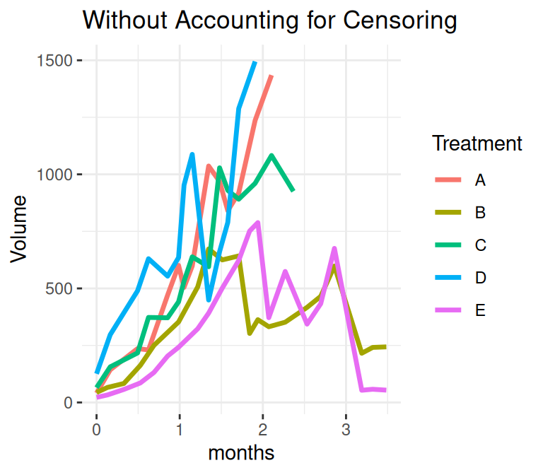

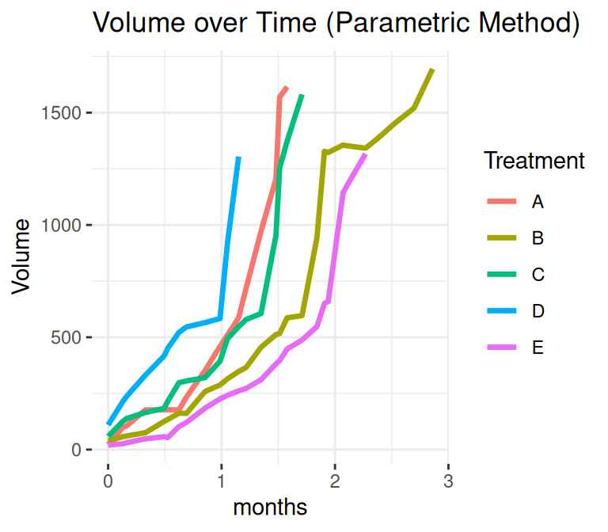

The plot on the left displays the mean tumor volume calculated from the
available observations at each time point. This approach does not
account for the structure of missingness commonly encountered in tumor
growth studies, where subjects may leave the study because of censoring
or dropout. As a result, an apparent decline in average tumor volume may
arise from a progressively smaller and potentially selective subset of
subjects rather than a true biological reduction in tumor growth.

In contrast, the parametric approach shown in the right panel estimates
group-level growth trajectories, providing a more accurate
representation of tumor growth dynamics over time.

### Individual tumor growth trajectories

Setting `panel = TRUE` displays individual tumor growth trajectories and
estimated group-level curves in separate panels for each treatment
group. This allows the variation among individual subjects to be
examined alongside the estimated growth trend for each treatment group.

``` r

plot(mel2, par = TRUE, fold = FALSE, panel = TRUE)
```

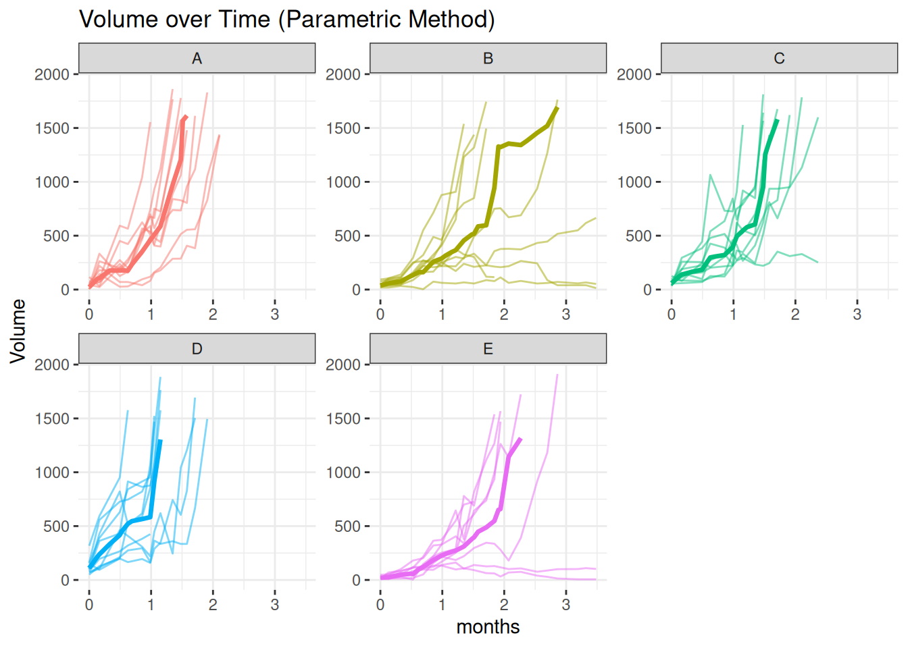

### Logarithmic scale and fold change

Tumor growth can also be examined on a logarithmic scale, which is
particularly useful when tumor volumes span a wide range or exhibit
approximately exponential growth.

The `fold` argument controls whether the visualization displays the
original tumor volume (`fold = FALSE`) or fold change relative to
baseline (`fold = TRUE`).

The following figures display both measurements on a logarithmic scale.

``` r

plot(mel2, par = TRUE, fold = FALSE) +
  ggplot2::scale_y_log10()
plot(mel2, par = TRUE, fold = TRUE) +
  ggplot2::scale_y_log10()
```

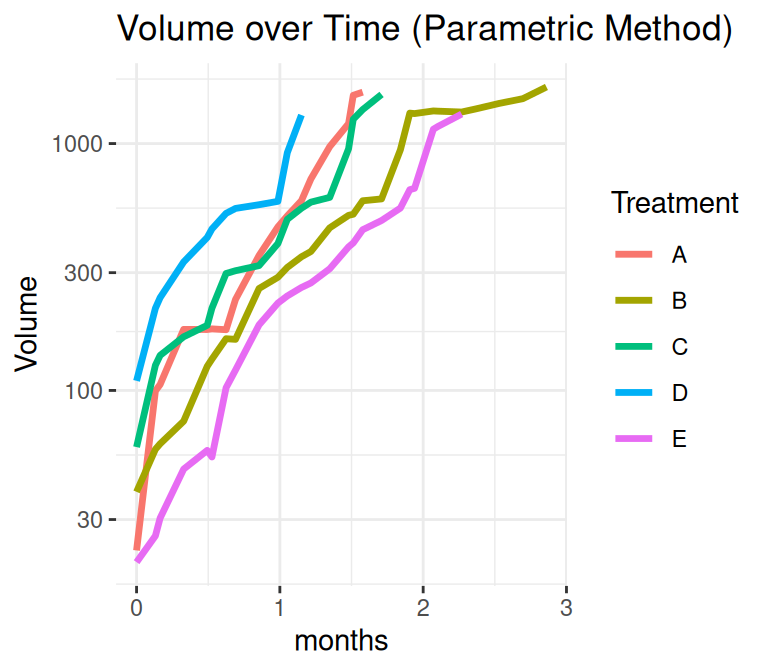

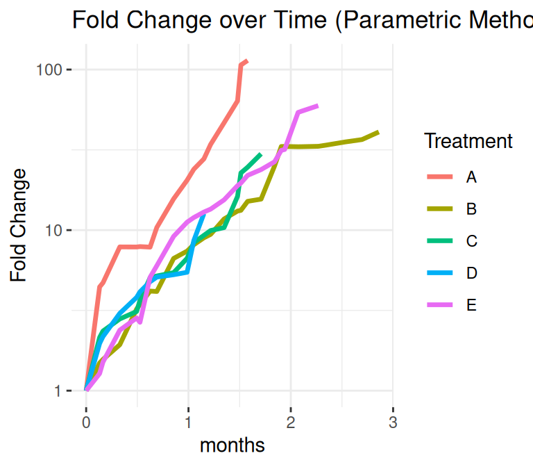

The same options can be combined with `panel = TRUE` to display
individual trajectories and estimated group-level curves separately for
each treatment group.

``` r

plot(mel2, par = TRUE, fold = FALSE, panel = TRUE) +
  ggplot2::scale_y_log10()
```

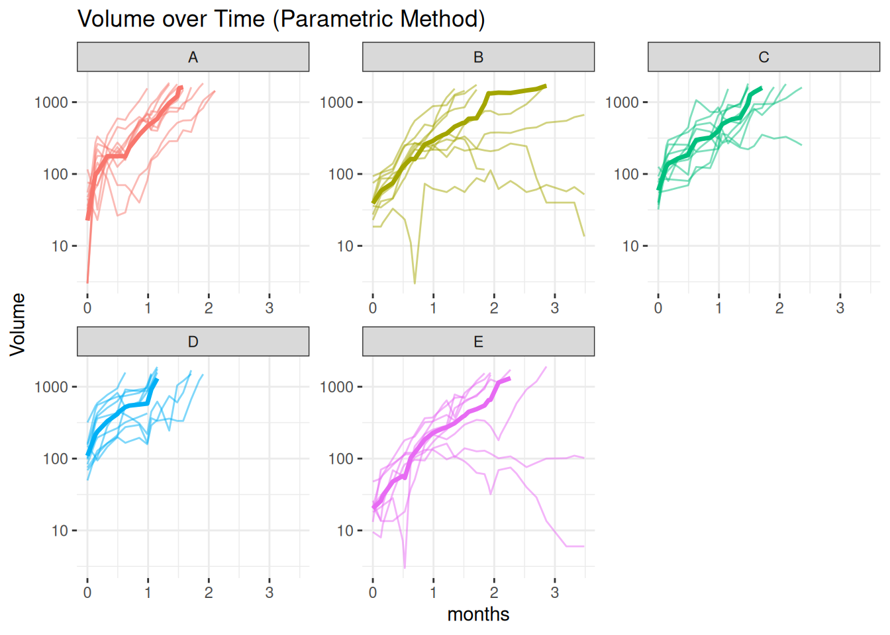

``` r

plot(mel2, par = TRUE, fold = TRUE, panel = TRUE) +
  ggplot2::scale_y_log10()
```

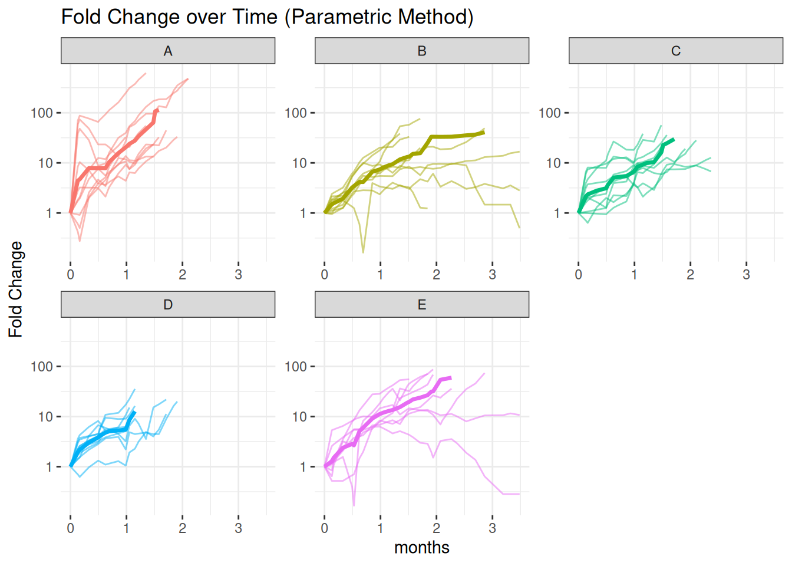

## Linear mixed-effects models

In addition to visualization, `tumr` provides tools for statistical
modeling of longitudinal tumor growth data.

The [`lmm()`](https://pbreheny.github.io/tumr/reference/lmm.md) function
fits a linear mixed-effects model, which is well suited for repeated
tumor measurements because it accounts for correlation among
observations from the same subject.

Linear mixed-effects models incorporate two types of effects:

- **Fixed effects:** Population-level effects of interest, such as
  treatment, time, and their interaction.
- **Random effects:** Subject-specific deviations that account for
  individual variability and within-subject correlation.

By default, the model includes treatment, time, and their interaction as
fixed effects, together with subject-specific random intercepts and
slopes.

The model can be represented schematically as:

`log(measure) ~ group * time + (time | id)`

This specification allows each subject to have an individual growth
trajectory while estimating overall treatment effects. The model formula
can also be customized if desired.

### Fitting the model

The [`lmm()`](https://pbreheny.github.io/tumr/reference/lmm.md) function
accepts a `tumr` object directly.

``` r

lmm_mel2 <- lmm(mel2)
```

### Summarizing model results

The [`summary()`](https://rdrr.io/r/base/summary.html) method uses the
`emmeans` package to report:

1.  The overall effect of time.
2.  Treatment-specific growth slopes over time.
3.  Statistical comparisons of growth slopes between treatment groups.

``` r

summary(lmm_mel2)
```

    $`overall effect of time`
     1       months.trend    SE   df lower.CL upper.CL
     overall         1.68 0.123 45.1     1.43     1.92

    Results are averaged over the levels of: Treatment
    Degrees-of-freedom method: satterthwaite
    Confidence level used: 0.95

    $`slope of treatment over time`
     Treatment months.trend    SE   df lower.CL upper.CL
     A                 2.35 0.268 47.3    1.808     2.88
     B                 1.23 0.270 39.9    0.681     1.77
     C                 1.62 0.263 44.4    1.096     2.15
     D                 1.68 0.287 58.8    1.110     2.26
     E                 1.50 0.283 38.4    0.927     2.07

    Degrees-of-freedom method: satterthwaite
    Confidence level used: 0.95

    $`test slope differences`
     contrast estimate    SE   df t.ratio p.value
     A - B      1.1203 0.380 43.3   2.949  0.0389
     A - C      0.7217 0.375 45.8   1.924  0.3193
     A - D      0.6618 0.393 53.0   1.685  0.4517
     A - E      0.8471 0.389 42.3   2.175  0.2088
     B - C     -0.3987 0.376 42.0  -1.059  0.8260
     B - D     -0.4585 0.394 48.6  -1.164  0.7716
     B - E     -0.2732 0.391 39.1  -0.699  0.9554
     C - D     -0.0599 0.389 51.5  -0.154  0.9999
     C - E      0.1255 0.386 41.0   0.325  0.9975
     D - E      0.1854 0.403 47.2   0.460  0.9905

    Degrees-of-freedom method: satterthwaite
    P value adjustment: tukey method for comparing a family of 5 estimates 

These results provide information about the estimated tumor growth rates
and whether the rates differ across treatment groups.

### Visualizing model results

The [`plot()`](https://rdrr.io/r/graphics/plot.default.html) method for
fitted [`lmm()`](https://pbreheny.github.io/tumr/reference/lmm.md)
objects provides three types of visualizations:

1.  Predicted tumor growth trajectories over time.
2.  Predicted fold change over time.
3.  Estimated mean growth slopes for each treatment group with
    confidence intervals.

The first two plots show the predicted tumor volume and fold change over
time.

``` r

plot(lmm_mel2, "predict")
```

    Model has log transformed response. Predictions are on transformed
      scale.

``` r

plot(lmm_mel2, "predict_fold") +
  ggplot2::scale_y_log10()
```

    Model has log transformed response. Predictions are on transformed
      scale.

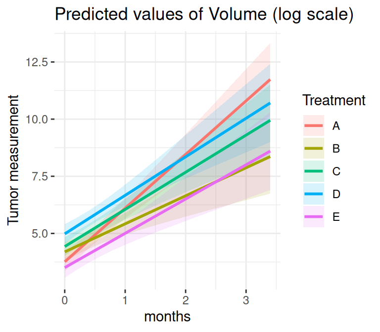

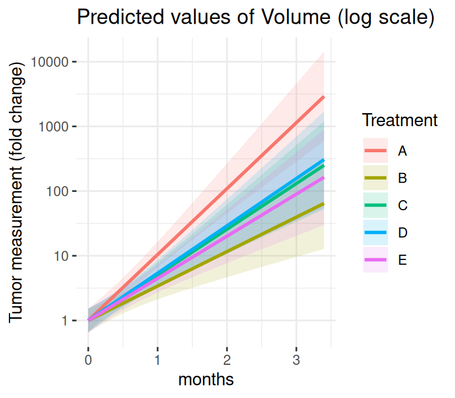

Treatment-specific growth slopes and their confidence intervals can also
be visualized using the `"contrast"` option.

``` r

plot(lmm_mel2, "contrast")
```

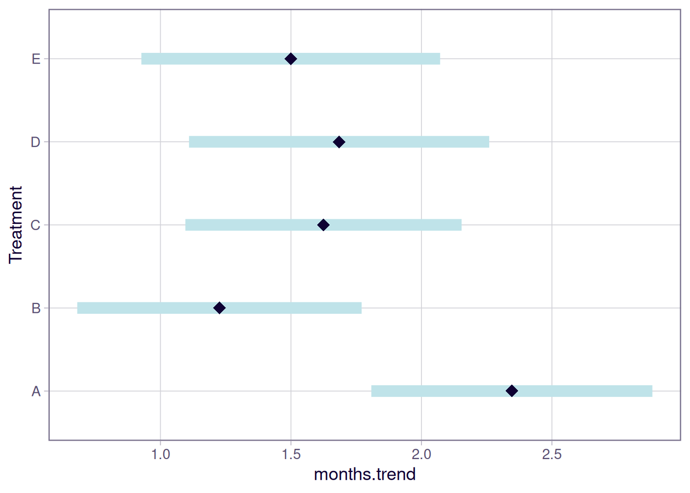

This visualization facilitates comparisons of estimated growth rates
across treatment groups.

### Tumor doubling time

The [`dtime()`](https://pbreheny.github.io/tumr/reference/dtime.md)
function estimates tumor doubling times from the fitted linear
mixed-effects model, providing an interpretable measure of tumor growth
rate.

``` r

dtime(lmm_mel2, seed = 123, nsim = 1000)
```

    $method
    [1] "Tumor Doubling Time Based on Linear Mixed Model"

    $message
    [1] "The model should demonstrate an exponential growth pattern."

    $summary
      Treatment mean median q2.5 q97.5
    1         A 0.30   0.29 0.24  0.38
    2         B 0.61   0.57 0.40  1.00
    3         C 0.44   0.43 0.33  0.63
    4         D 0.42   0.41 0.31  0.61
    5         E 0.48   0.46 0.34  0.73

The `seed` argument ensures reproducibility, and `nsim` specifies the
number of simulations.

### Checking for exponential growth

The default linear mixed-effects modeling approach assumes an
approximately linear relationship between log-transformed tumor volume
and time.

Because a straight line on the log-volume scale corresponds to
exponential growth on the original scale, the adequacy of this
assumption can be assessed by examining model residuals over time.

The
[`check_exp()`](https://pbreheny.github.io/tumr/reference/check_exp.md)
function provides a diagnostic visualization for evaluating the
exponential growth assumption.

``` r

check_exp(lmm_mel2)
```

    `geom_smooth()` using formula = 'y ~ x'

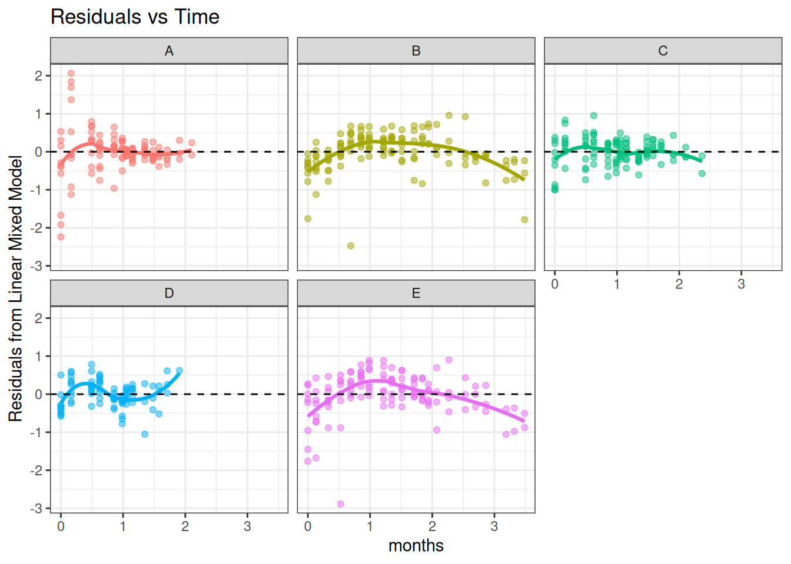

Systematic patterns in the residuals may indicate departures from
exponential growth and suggest that a more flexible model is needed.

## Further reading

The `tumr` package provides several additional useful methods for
analyzing tumor growth data. These articles provide more detailed
explanations, examples, and additional modeling options.

- [Response feature
  analysis](https://pbreheny.github.io/tumr/articles/response-features.md)

- [Exponential quadratic
  model](https://pbreheny.github.io/tumr/articles/quadratic.md)

- [Generalized Additive Model
  (GAM)](https://pbreheny.github.io/tumr/articles/gam.md)

- [Bayesian hierarchical Linear
  Model](https://pbreheny.github.io/tumr/articles/bhm.md)
